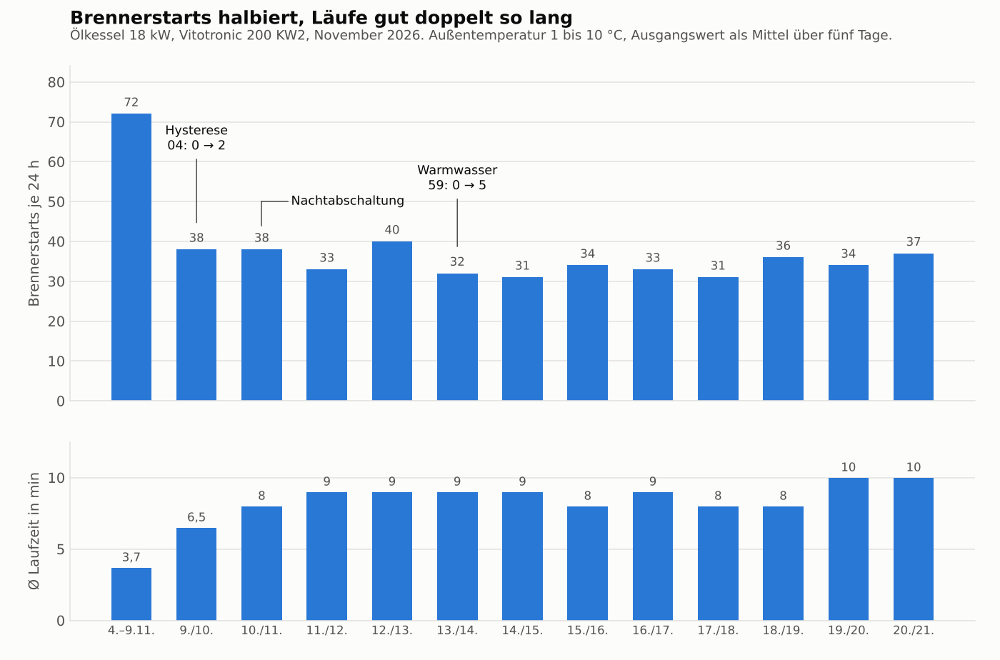
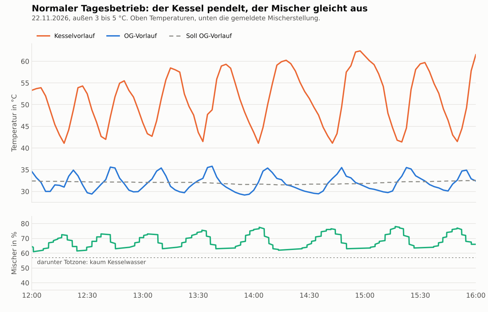
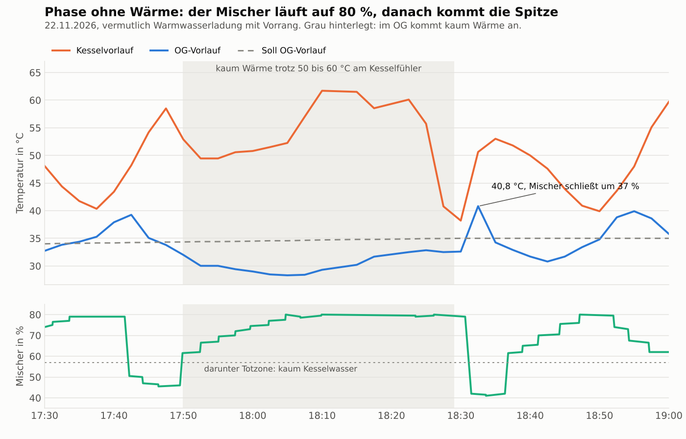
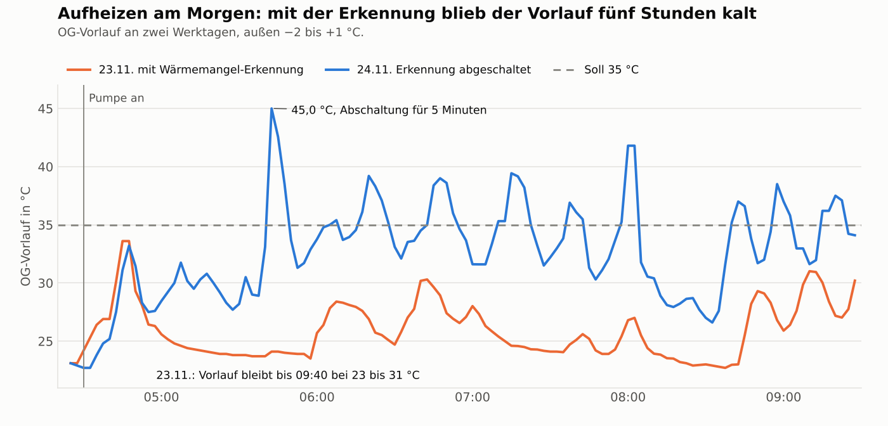

# Heizungsdiagramme November 2026

Diagramme zu zwei Forenbeiträgen über ein Einfamilienhaus mit Ölkessel (Viessmann, 18 kW, Vitotronic 200 KW2).

## Brennertaktung

## Fußboden-Mischerregelung mit Homematic IP

Alle Werte selbst gemessen. Stand 24.11.2026.
